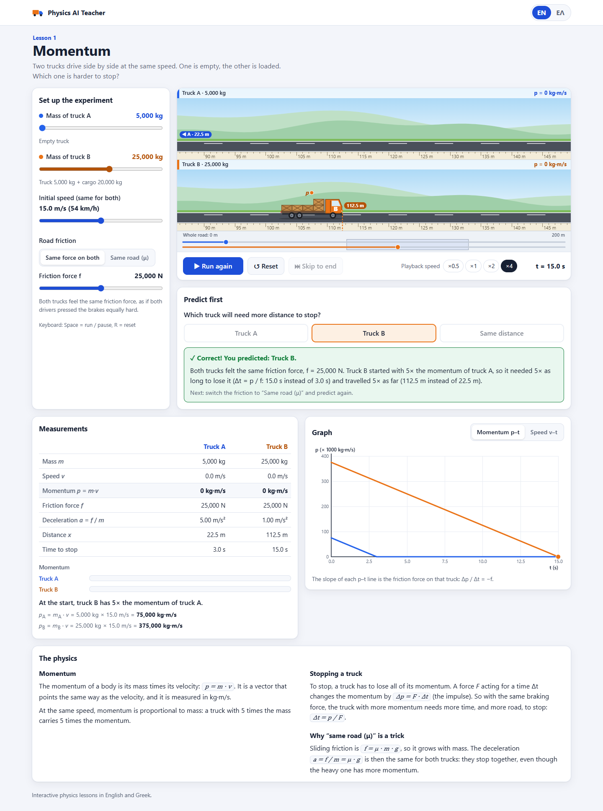
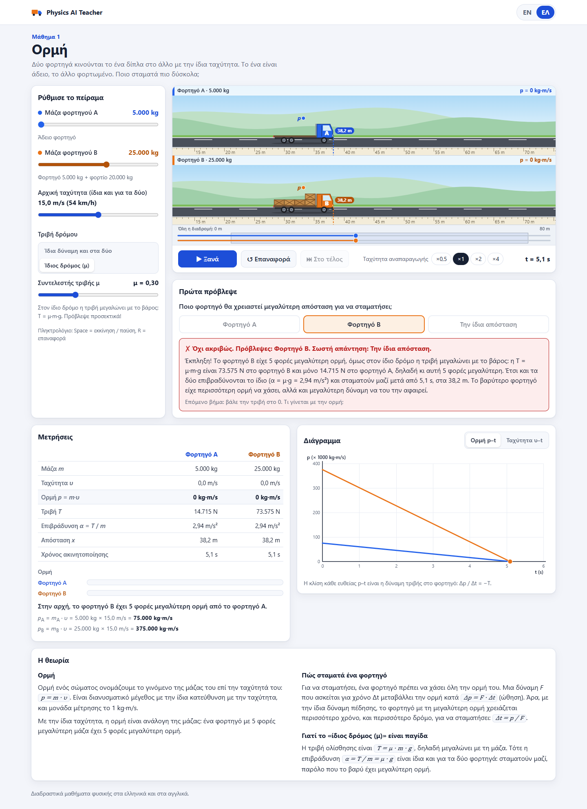

# Physics AI Teacher

Interactive physics lessons in **English and Greek** that run in the browser, with nothing to install. The site is static TypeScript, published on GitHub Pages.

## Lesson 1: Momentum (Ορμή)

Two trucks drive side by side at the same speed. One is empty and the other is loaded. Which one is harder to stop?



The student can:

- **Set the mass of each truck**, from 5,000 kg (empty) to 40,000 kg (fully loaded). The crates on the truck grow with the cargo.
- **Set the initial speed**, shared by both trucks: 0 to 30 m/s (0 to 108 km/h).
- **Set the road friction**, from 0 upwards, in one of two modes:
  - **Same force on both** (default): both trucks feel the same friction force, as if both drivers braked equally hard. The loaded truck has more momentum, so it needs more time and more road to stop (Δt = p / F). This is the classic momentum demonstration.
  - **Same road (μ)**: friction is μ·m·g, so it grows with the mass. Both trucks slow down at μ·g and **stop together**, even though their momenta differ. This makes a good trick question once students have the first idea.
  - **Friction 0**: nothing slows the trucks down, and their momentum stays constant (Newton's first law).
- **Predict, then run**: before the run, students pick which truck will need more distance to stop. After it, they get a verdict and an explanation built from the numbers of that run, plus a suggestion for the next experiment.
- **Watch and measure**: momentum arrows drawn to scale, a ruler along each road, stop markers, an overview of the whole road, a live table (m, v, p = m·v, friction, deceleration, distance, time to stop), momentum bars, and a p–t or v–t graph whose slope is the friction force or the deceleration.
- **Control playback**: run, pause, reset, skip to the end, and ×0.5 to ×4 speed. On a keyboard, Space runs or pauses and R resets.

The Greek version follows the school textbook conventions: υ for velocity, T for friction, α for acceleration, Α / Β for the trucks, and decimal commas (15,0 m/s, 375.000 kg·m/s).



### Language

The **EN / ΕΛ** switch is in the top right corner, and the browser remembers the choice. A link can also set the language: add `?lang=el` or `?lang=en` to the address. If neither is set, the page follows the browser's language.

## Development

Requires Node.js 22.12 or newer (`.nvmrc` pins 24 for CI).

```sh
npm install
npm run dev          # open the printed localhost URL
```

| Script | What it does |
| --- | --- |
| `npm run dev` | Dev server with hot reload |
| `npm run build` | Type-check, then production build to `dist/` |
| `npm run preview` | Serve the production build locally |
| `npm run typecheck` | Type-check the app and the tooling/tests |
| `npm run lint` | Lint with [oxlint](https://oxc.rs) (warnings fail) |
| `npm test` | Unit tests with [Vitest](https://vitest.dev) |
| `npm run test:e2e` | End-to-end tests with [Playwright](https://playwright.dev) against the production build |
| `npm run check` | Lint, unit tests, type-check and build in one go |

The end-to-end tests use Playwright's Chromium. Install it once with `npx playwright install chromium`, or use a browser you already have, for example `PW_CHANNEL=msedge npm run test:e2e`.

### Testing

- **Unit tests** (`src/**/*.test.ts`) cover the physics: p = m·v, the impulse-momentum theorem, stopping times and distances in both friction modes, no friction, trucks at rest, and the answer to the prediction question. They also check the graph lines, the camera, number formatting in each language, and language detection. Another test makes sure the English and Greek text have the same keys and `{placeholders}`, and that every `data-i18n` key in the markup exists.
- **End-to-end tests** (`e2e/`) build the site and use it in a real browser. They check that it loads without errors, makes no third-party requests, ships a strict CSP, and shows live momentum values. They also run each kind of experiment (same force, same road, no friction), check pause, keyboard and reset, and switch to Greek. A phone project checks that the page fits a phone screen and works with taps.

### Project structure

```text
src/
  main.ts                  entry point: language switch, mounts the lesson
  app-strings.ts           header and footer text (EN / EL)
  style.css                layout and theme (light by default, dark when the device asks)
  i18n/i18n.ts             language detection and switching, translations, number formatting
  lib/nice.ts              round numbers for axes and rulers
  lessons/momentum/
    physics.ts             exact motion of two braking trucks (no step-by-step integration)
    lesson.ts              state (ready, running, paused, finished), controls, readouts, prediction, explanations
    scene.ts               canvas drawing: roads, trucks, momentum arrows, ruler, overview
    graph.ts               p–t / v–t graph
    strings.ts             all lesson text in English and Greek
    template.ts            lesson markup (text comes from strings.ts)
e2e/                       Playwright end-to-end tests
.github/                   CI/CD workflow and Dependabot config
```

### Adding a lesson

Create a folder under `src/lessons/` with the same parts: physics, strings (both languages), template, and a `mount…Lesson(root)` function. Then mount it from `main.ts`. Once there are several lessons, `main.ts` is the place to add a lesson menu.

## Security and privacy

- **No third parties:** no analytics, trackers, cookies, CDNs or web fonts. Text uses the device's system font, which covers Greek. An end-to-end test enforces this.
- **Strict Content-Security-Policy** in the production build: `default-src 'self'`, no inline scripts or styles, no `eval`, no plugins, no forms.
- **Stored data:** only the language choice, in the browser's own `localStorage`.

## Deploy to GitHub Pages

The build uses relative asset paths (`base: './'`), so it works from `https://<user>.github.io/<repo>/`. The workflow in `.github/workflows/ci.yml` runs lint, tests and the build on every push and pull request, and deploys `main` when everything passes.

1. Create a GitHub repository (for example `PhysicsAITeacher`) and push this project to its `main` branch.
2. In the repository, go to **Settings > Pages > Build and deployment** and set **Source** to **GitHub Actions**.
3. Push to `main`. The site goes live at `https://<user>.github.io/PhysicsAITeacher/`.

GitHub Pages on a free account needs a **public** repository. Publishing from a private repository needs a paid plan (GitHub Pro, Team or Enterprise), and even then the published site is public.
