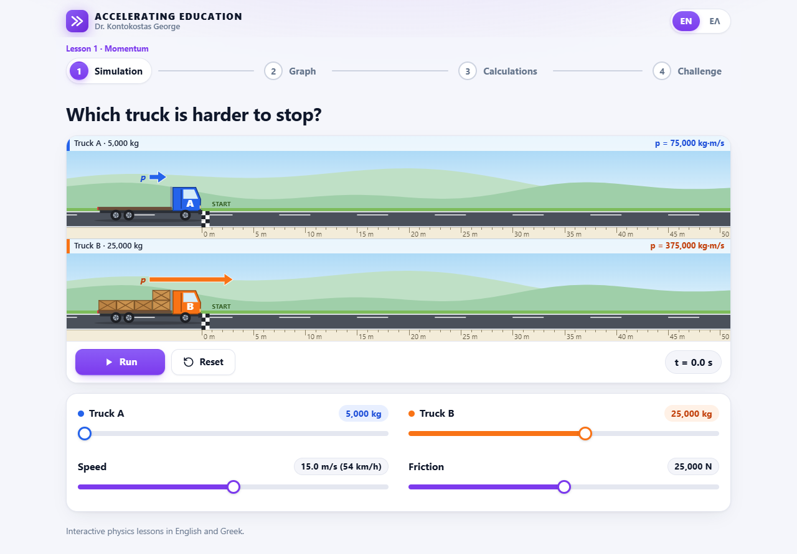
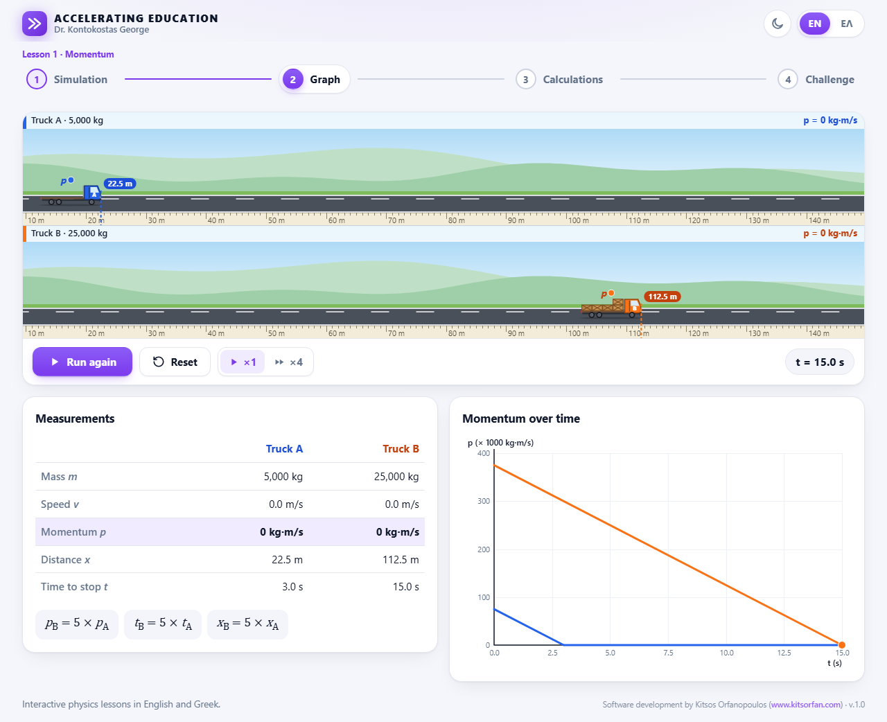
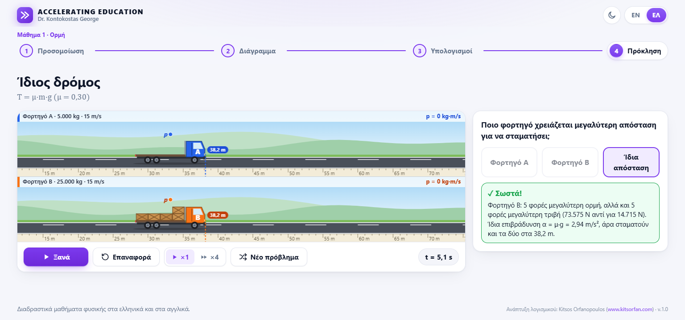

# Accelerating Education

Interactive physics lessons by **Dr. Kontokostas George**, in **English and Greek**. They run in the browser with nothing to install: a static TypeScript site published on GitHub Pages.

**Open it:** <https://kitsorfan.github.io/AcceleratingEducation/>

The pages are kept short on purpose. The teacher explains, and the page shows the experiment, the numbers and the formulas.

## Lesson 1: Momentum (Ορμή)

Two trucks drive side by side at the same speed. One is empty and the other is loaded. Which one is harder to stop?



A stepper at the top (**Simulation · Graph · Calculations · Challenge**) moves between the steps at any time. It stays on screen while scrolling, and the address remembers the step (`#step-2`), so a link can open a specific step.

1. **Simulation:** the two trucks and five sliders: the mass (5,000 to 40,000 kg) and initial speed (0 to 30 m/s) of each truck, and the friction force (0 to 50,000 N, the same on both trucks). The crates grow with the cargo, and each truck's momentum arrow is drawn to scale.
2. **Graph:** the same road, plus a table (m, v, p, distance, time to stop), the p–t graph, and the comparison as formulas, e.g. `pB = 5 × pA`, `tB = 5 × tA`, `xB = 5 × xA`.
3. **Calculations:** p = m·v and F·Δt = Δp ⇒ Δt = p / F, worked out with the numbers from the simulation.
4. **Challenge:** the same road, where friction is μ·m·g. Students predict which truck needs more road, then run it. With the trucks from the simulation at the same speed (the default), both stop together, because a = μ·g for both. **New problem** deals new trucks with different masses and speeds, so the answer can be either truck or the same distance: only the speed decides it (x = v² / 2μg).



Why "same force" is the default: if friction were μ·m·g, the heavier truck would also feel a proportionally bigger force, and both trucks would stop at the same spot. That would hide the momentum difference, so the main experiment applies the same friction force to both trucks, and the μ·m·g case becomes the challenge.

Long runs (very low friction) play faster, so a run never takes much more than 20 seconds. The **×1 | ×4** switch next to Reset turns fast forward on (four times faster, on top of that) and back to normal speed; it stays as set across runs. The clock shows the speed-up, e.g. "(×3)". On a keyboard, Space runs or pauses, R resets, F toggles fast forward and, on the challenge, N deals a new problem.

The Greek version follows the school textbook conventions: υ for velocity, T for friction, α for acceleration, Α / Β for the trucks, and decimal commas.



### Language

The **EN / ΕΛ** switch is in the top right corner, and the browser remembers the choice. A link can set the language too: add `?lang=el` or `?lang=en`. Otherwise the page follows the browser's language.

## Development

Requires Node.js 22.12 or newer (`.nvmrc` pins 24 for CI).

```sh
npm install
npm run dev          # open the printed localhost URL
```

| Script | What it does |
| --- | --- |
| `npm run dev` | Dev server with hot reload |
| `npm run build` | Type-check, then production build to `dist/` |
| `npm run preview` | Serve the production build locally |
| `npm run typecheck` | Type-check the app and the tooling/tests |
| `npm run lint` | Lint with [oxlint](https://oxc.rs) (warnings fail) |
| `npm test` | Unit tests with [Vitest](https://vitest.dev) |
| `npm run test:e2e` | End-to-end tests with [Playwright](https://playwright.dev) against the production build |
| `npm run check` | Lint, unit tests, type-check and build in one go |

The end-to-end tests use Playwright's Chromium. Install it once with `npx playwright install chromium`, or use a browser you already have, for example `PW_CHANNEL=msedge npm run test:e2e`.

### Testing

- **Unit tests** (`src/**/*.test.ts`) cover the physics: p = m·v, the impulse-momentum theorem, stopping times and distances with the same force and on the same road, no friction, and trucks at rest. They also cover the camera, the graph line, playback speed-up, step links, number formatting per language, and language detection. Another test keeps the English and Greek text in sync: same keys, same `{placeholders}`, and every key used in the markup defined.
- **End-to-end tests** (`e2e/`) build the site and use it in a real browser. They check that it loads cleanly with no third-party requests and ships a strict CSP. They also test the four steps and the stepper, a run that continues across steps, pause and reset, no friction, the challenge, and Greek. On a phone, they check that every step fits the screen and that the stepper stays in reach.

### Project structure

```text
src/
  main.ts                  entry point: language switch, mounts the lesson
  app-strings.ts           header and footer text (EN / EL)
  style.css                theme and layout (light by default, dark when the device asks)
  i18n/i18n.ts             language detection and switching, translations, number formatting
  lib/nice.ts              round numbers for axes and rulers
  lessons/momentum/
    physics.ts             exact motion of two braking trucks (no step-by-step integration)
    lesson.ts              steps, run state, sliders, readouts, calculations, challenge
    scene.ts               canvas drawing: roads, trucks, momentum arrows, ruler, camera
    graph.ts               p–t graph
    strings.ts             all lesson text in English and Greek
    template.ts            lesson markup and icons (text comes from strings.ts)
e2e/                       Playwright end-to-end tests
.github/                   CI/CD workflow and Dependabot config
```

To add a lesson, create a folder under `src/lessons/` with the same parts, and mount it from `main.ts`.

## Security and privacy

- **No third parties:** no analytics, trackers, cookies, CDNs or web fonts. Text uses the device's system font, which covers Greek. An end-to-end test enforces this.
- **Strict Content-Security-Policy** in the production build: `default-src 'self'`, no inline scripts or styles, no `eval`, no plugins, no forms.
- **Stored data:** only the language choice, in the browser's own `localStorage`.

## Deploy to GitHub Pages

The build uses relative asset paths (`base: './'`), so it works from `https://<user>.github.io/<repo>/`. The workflow in `.github/workflows/ci.yml` runs lint, tests and the build on every push and pull request, and deploys `main` when everything passes.

1. Create the public GitHub repository `AcceleratingEducation` and push this project to its `main` branch.
2. In the repository, go to **Settings > Pages > Build and deployment** and set **Source** to **GitHub Actions**.
3. Push to `main`. The site goes live at <https://kitsorfan.github.io/AcceleratingEducation/>.

Software development by Kitsos Orfanopoulos ([www.kitsorfan.com](https://www.kitsorfan.com)).
